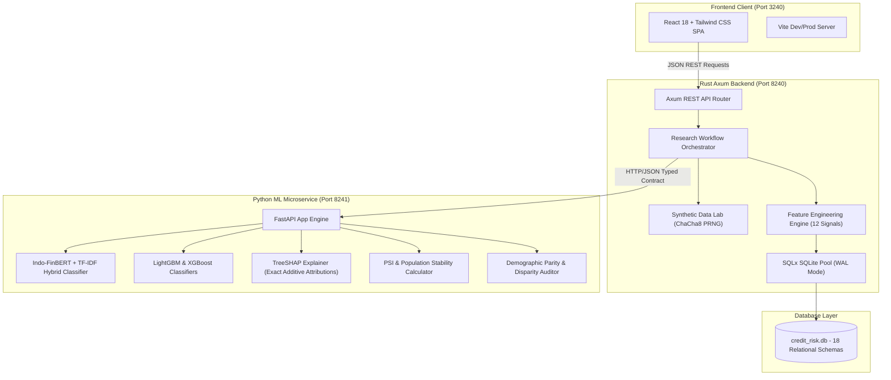

# AI Dynamic Credit Risk Research & Monitoring Platform

**Academic Research Prototype | Synthetic Data Only | Non-Production Environment**

---

## 1. Overview & Research Objectives

The **AI Dynamic Credit Risk Research & Monitoring Platform** is an empirical, research-grade software platform built to explore explainable artificial intelligence (XAI), non-linear tree-based credit default modeling, natural language understanding of transaction narratives, and event-driven dynamic risk surveillance.

### Core Governance & Academic Constraints
- **100% Synthetic Data:** No real customer, banking, or credit bureau data is ingested. All records are mathematically simulated using reproducible PRNG generators.
- **Strict Anti-Leakage Design:** Default distress labels are determined downstream through simulated cash flow depletion and severe delinquencies, strictly isolated from input feature pipelines.
- **Attribution != Causation:** All SHAP feature attribution metrics reflect game-theoretic marginal contribution to tree split partitions, not physical causal relationships.
- **Non-Binding Lending Decisions:** The platform functions as decision support for research and validation. No automated or binding credit commitments are generated.

---

## 2. System Architecture & Interconnects



---

## 3. Database Architecture (18 Relational Schemas)

All database records are flagged with `is_synthetic = 1` for strict data provenance:

1. `research_datasets`: Metadata, versioning, customer count, PRNG seed, and embedded data dictionary JSON.
2. `synthetic_customers`: Customer code, simulation profile, employment, income, expenses, obligations, research cohort.
3. `synthetic_accounts`: Checking, savings, and credit accounts with running balances.
4. `bank_transactions`: Time-series debits and credits with bilingual financial descriptions and verified running balances.
5. `utility_payments`: Electricity (PLN), Water (PDAM), Telco billing cycles, payment statuses, and days past due (DPD).
6. `transaction_classifications`: Categorization tags, confidence scores, and reliability flags.
7. `feature_snapshots`: Pre-computed 12 mathematical risk features with formulas and units.
8. `credit_assessments`: Calibrated Probability of Default (PD), risk categories, uncertainty scores, and review statuses.
9. `model_registry`: Registered model algorithms (LightGBM, XGBoost, Baseline LogReg).
10. `model_versions`: Serialized model artifacts, hyperparameters, dataset bindings, and seeds.
11. `model_experiments`: Training run lifecycle, temporal split strategies, and metrics tracking.
12. `model_evaluations`: ROC-AUC, PR-AUC, F1, Brier calibration scores, log loss, and confusion matrices.
13. `shap_explanations`: Base values, local waterfall contributions, global importance, and directionality.
14. `monitoring_events`: Temporal shock events (income drop, expense surge, utility delinquency).
15. `drift_reports`: Population Stability Index (PSI) and distribution shifts.
16. `reassessment_history`: Chronological audit of PD shifts, risk score deltas, and triggering reasons.
17. `review_records`: Underwriter manual review simulation, committee override decisions, and documented justifications.
18. `audit_logs`: Immutable security, training, and assessment audit trail.

---

## 4. Synthetic Simulation Profiles

The generator provides 8 deterministic scenarios:
- **Stable Income:** Corporate employee with reliable salary and disciplined liquidity buffers.
- **Variable Income:** Freelancers or sales commission earners with moderate cash flow fluctuation.
- **Irregular Income:** Seasonal contract workers with periodic cash flow lulls.
- **High Expense Burden:** Elevated debt-to-income (>60%) with thin liquidity reserves.
- **Consistent Payment:** Civil servant profile with 100% on-time utility and credit obligations.
- **Irregular Payment:** Small informal merchants with occasional 15-45 DPD utility delinquency.
- **Thin-file Customer:** Junior professionals with brief account histories and minimal credit lines.
- **No Credit History:** First-time account holders with zero historical debt lines.

---

## 5. Mathematical Feature Engineering Catalog

12 explicit features computed from 6 months of historical transactions and utility cycles:
1. `avg_monthly_income`: Mean monthly credit deposits (IDR).
2. `income_variability`: Coefficient of variation of monthly deposits ($std / mean$).
3. `monthly_expense`: Mean monthly debits (IDR).
4. `net_cash_flow`: Net operating cash flow ($income - expenses$).
5. `avg_balance`: Time-weighted average running balance (IDR).
6. `cash_flow_volatility`: Coefficient of variation of transaction-level net cash flows.
7. `expense_to_income_ratio`: Monthly expense burden ratio ($expenses / income$).
8. `recurring_payment_consistency`: Ratio of scheduled obligation installments met ($0.0 - 1.0$).
9. `utility_regularity_score`: On-time utility bill payments ratio ($0.0 - 1.0$).
10. `payment_burden_ratio`: Stated credit installment obligations divided by income.
11. `transaction_frequency`: Average transactions per month.
12. `data_completeness_score`: Proportion of non-null, valid financial signals ($0.0 - 1.0$).

---

## 6. Port Allocations & Services

| Service | Target Port | Protocol | Description |
| :--- | :---: | :---: | :--- |
| **Frontend UI** | `3240` | HTTP | Vite + React + Tailwind CSS SPA |
| **Rust Backend API** | `8240` | HTTP | Axum + Tokio REST API & Orchestrator |
| **Python ML Microservice** | `8241` | HTTP | FastAPI + LightGBM + XGBoost + SHAP |
| **SQLite Database** | `Local` | File/WAL | `data/credit_risk.db` (18 Schemas) |

---

## 7. Launch Instructions

### Quick Start (Windows)
```cmd
start.bat
```
To stop all services gracefully:
```cmd
stop.bat
```

### Quick Start (Linux / Mac / Git Bash)
```bash
./scripts/start.sh
```
To stop all services:
```bash
./scripts/stop.sh
```

---

## 8. Verification & Test Evidence

All automated test suites have been executed and verified:

### Rust Backend
```bash
cd backend
cargo test
# Result: 3 passed (determinism, data integrity, leakage protection); 0 failed

cargo clippy --all-targets --all-features -- -D warnings
# Result: Finished clean with 0 warnings

cargo fmt --check
# Result: Formatted according to official style guidelines
```

### Python ML Service
```bash
cd ml_service
python -m pytest tests/test_ml_service.py -v
# Result: 5 passed in 13.30s (NLP classification, LightGBM training, TreeSHAP, PSI drift, Fairness audit)
```

### Frontend Production Build
```bash
cd frontend
npm run build
# Result: 1514 modules transformed; 0 errors; built dist/ in 23.19s
```
